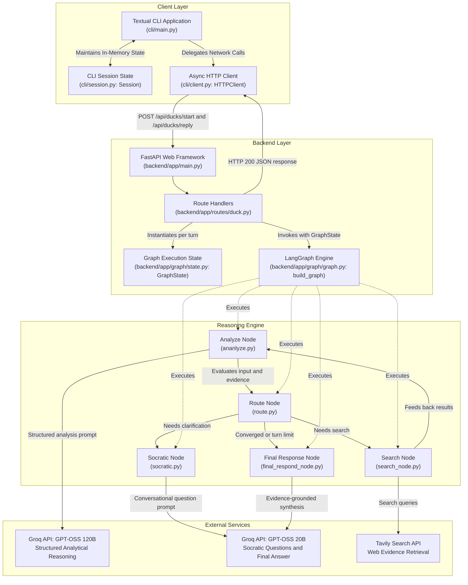
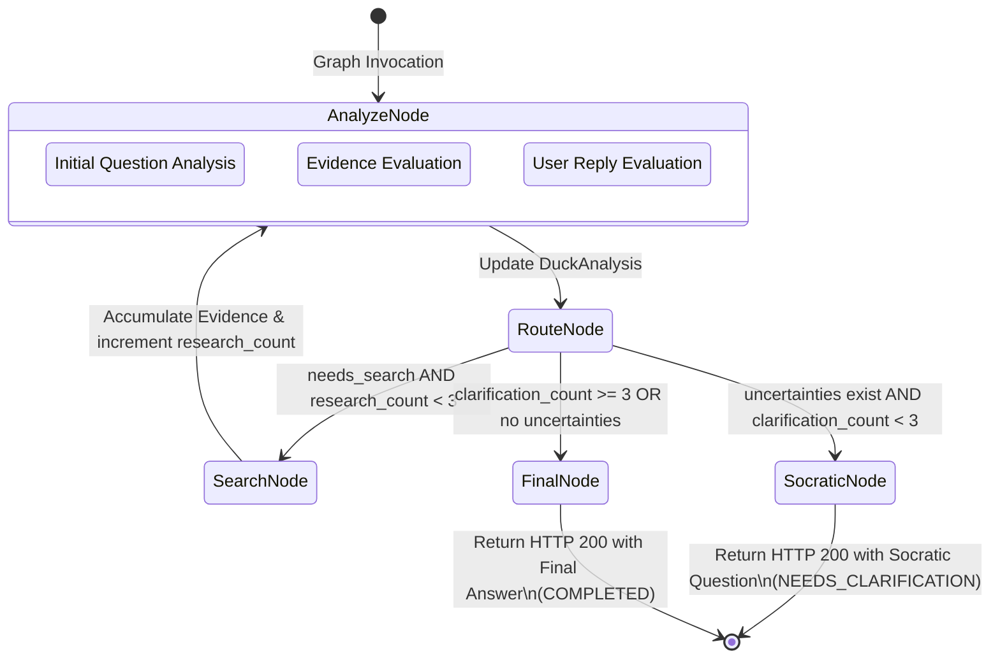

# RubberDuck Architecture

## 1. Project Overview

RubberDuck is an interactive debugging and critical thinking assistant built with FastAPI, LangGraph, Groq, and Tavily. The system applies the Socratic method to software problem solving. Instead of generating immediate speculative solutions, RubberDuck analyzes problem descriptions, surfaces hidden assumptions, tracks knowledge gaps, asks clarifying questions, and gathers external evidence when needed.

### Primary Purpose
Software engineers often make unverified assumptions when diagnosing complex bugs or system behaviors. RubberDuck serves as an automated dialogue partner that prompts engineers to articulate their logic, test edge cases, and inspect assumptions before settling on a solution.

### Core Design Philosophy
1. **Iterative Socratic Inquiry**: Prompt the user with targeted questions that expose ambiguities rather than offering premature conclusions.
2. **Deterministic State Transitions**: Orchestrate reasoning cycles through a finite-state workflow using LangGraph, preventing runaway loops and unpredictable recursion.
3. **Evidence Grounding**: Require external factual assertions to be backed by retrieved web evidence from Tavily, with explicit source citations.
4. **Separation of Analytical and Conversational Concerns**: Distinct LLM nodes handle structured reasoning, conversational question generation, and final answer synthesis.
5. **Bounded Execution**: Strict limits govern internal research loops and user clarification turns, ensuring deterministic termination.
6. **Stateless Backend Design**: The server relies on client-held state across HTTP turns, eliminating server-side session databases and distributed cache requirements.

### Problems Addressed
- **Premature Problem Resolution**: Standard LLM chats frequently produce hallucinated or irrelevant code fixes because they accept initial user statements without scrutiny.
- **Unbounded Agent Loops**: Automated agent workflows without explicit terminal state guarantees can loop indefinitely when uncertainties persist.
- **Lost Context and Stale Clarifications**: Unstructured multi-turn chats often lose track of identified uncertainties across turns.
- **Unverified Assertions**: Technical statements made without supporting documentation or reference materials.

---

## 2. Technology Stack

RubberDuck uses the following languages, frameworks, and third-party services:

| Component | Technology | Version | Purpose |
|---|---|---|---|
| Language | Python | 3.11+ | Primary implementation language |
| Web Framework | FastAPI | 0.124.4 | REST API endpoints for starting and continuing reasoning sessions |
| ASGI Server | Uvicorn | 0.38.0 | High-performance asynchronous HTTP server |
| Graph Engine | LangGraph | 1.0.4 | State graph orchestration for the reasoning lifecycle |
| Schema Validation | Pydantic | 2.12.5 | Request, response, and internal state data validation |
| LLM Provider | Groq API | 0.37.1 (SDK) | Inference provider for fast LLM execution |
| Reasoning Model | `openai/gpt-oss-120b` | N/A | High-capacity model for structured analytical decomposition |
| Conversational Model | `openai/gpt-oss-20b` | N/A | Lightweight model for Socratic questions and final answers |
| Web Search | Tavily API | 0.8.5 (SDK) | Real-time search engine for gathering technical evidence |
| Terminal UI | Textual | 8.2.8 | Terminal user interface for developer interaction |
| Terminal Formatting | Rich | 14.2.0 | Formatted terminal output rendering |
| HTTP Client | HTTPX | 0.28.1 | Asynchronous HTTP client for CLI-to-backend communication |
| Test Framework | Pytest | 9.2.0 | Unit, functional, non-functional, and live integration test execution |

---

## 3. Repository Structure

The repository is structured into the backend application, CLI interface, tests, and configuration:

```text
rubber-duck/
├── backend/
│   ├── app/
│   │   ├── graph/
│   │   │   ├── nodes/
│   │   │   │   ├── ananlyze.py           # Analysis node handling initial, search, and clarification turns
│   │   │   │   ├── final_respond_node.py # Final response synthesis grounded in evidence
│   │   │   │   ├── route.py              # Deterministic routing logic for state transitions
│   │   │   │   ├── search_node.py        # Tavily search execution, deduplication, and evidence limits
│   │   │   │   └── socratic.py           # Socratic question generation node
│   │   │   ├── graph.py                  # LangGraph StateGraph builder and compilation
│   │   │   └── state.py                  # GraphState definition and ExecutionStatus enum
│   │   ├── routes/
│   │   │   └── duck.py                   # FastAPI REST routes (/api/ducks/start, /api/ducks/reply)
│   │   ├── schemas/
│   │   │   ├── analysis.py               # DuckAnalysis and DuckAnalysisContent schemas
│   │   │   ├── evidence.py               # DuckEvidence schema
│   │   │   ├── request.py                # DuckRequest schema
│   │   │   ├── response.py               # DuckResponse schema
│   │   │   └── search.py                 # DuckSearch schema
│   │   ├── services/
│   │   │   ├── llm_helper.py             # Groq client, retry logic, and JSON repair mechanisms
│   │   │   ├── model_registery.py        # Model identifier constants
│   │   │   └── parsed_response.py        # Generic ParsedResponse container
│   │   └── main.py                       # FastAPI entrypoint and /health route
│   ├── tests/
│   │   ├── functional/                   # 73 offline functional tests for contracts, graph, and CLI
│   │   ├── integration/                  # 4 live integration tests requiring API keys
│   │   ├── non_functional/               # 14 offline performance, robustness, and security tests
│   │   └── conftest.py                   # Pytest fixtures and mock factories
│   ├── .env                              # Backend environment variable file (local)
│   ├── .gitignore                        # Backend Git ignore rules
│   └── requirements.txt                  # Backend package dependencies
├── cli/
│   ├── client.py                         # Asynchronous HTTP client communicating with backend
│   ├── main.py                           # Textual terminal application and UI event loop
│   └── session.py                        # In-memory session state container for CLI
├── docs/
│   └── ARCHITECTURE.md                   # Consolidated architecture documentation
├── .gitignore                            # Root Git ignore rules
├── README.md                             # Project overview, quickstart, and command reference
└── requirements.txt                      # Root package dependencies
```

---

## 4. System Architecture

The RubberDuck system consists of four distinct architectural layers: a client terminal layer, a stateless backend service layer, a LangGraph-driven reasoning engine, and external inference and retrieval services.



### Component Roles
1. **Textual CLI**: Provides the terminal user interface, capturing user queries, displaying conversation history, showing assumptions and evidence, and routing user input.
2. **HTTP Client**: Manages asynchronous communication using HTTPX, handling connection timeouts, parsing error messages, and translating HTTP status codes into CLI exceptions.
3. **FastAPI Backend**: Validates incoming payloads using Pydantic, initializes the graph execution state, triggers graph runs, handles internal errors, and formats responses.
4. **LangGraph Reasoning Engine**: Orchestrates execution nodes across analysis, routing, search, Socratic questioning, and final response synthesis.
5. **Groq LLM Service**: Provides fast inference. A high-parameter model handles structured reasoning while a lightweight model handles single-turn plain text generation.
6. **Tavily Search Service**: Performs external web searches for factual claims, deduplicating snippets and formatting source metadata.

---

## 5. Backend Architecture

### API Routes
The backend exposes three endpoints in `backend/app/main.py` and `backend/app/routes/duck.py`:

- **`GET /health`**: Returns `{"status": "ok"}` for service health monitoring.
- **`POST /api/ducks/start`**: Initiates a new reasoning session with an initial problem statement.
- **`POST /api/ducks/reply`**: Submits a user clarification to continue an active session.

### Request and Response Schemas
Endpoints use Pydantic models with field-level validation:

- **`StartRequest`**:
  - `initial_question`: Non-empty string. Whitespace-only strings are rejected with HTTP 422.
- **`StartResponse`**:
  - `socratic_question`: String or `null` if the request was answered directly.
  - `final_answer`: String or `null` if clarification is required.
  - `analysis`: `DuckAnalysis` object containing analytical breakdown.
  - `turn_count`: Integer tracking the current turn index.
  - `evidence`: `DuckEvidence` object containing collected snippets, or `null`.
- **`ReplyRequest`**:
  - `initial_question`: Non-empty string.
  - `prev_socratic_q`: The Socratic question being answered.
  - `user_reply`: Non-empty string containing the user's clarification.
  - `analysis`: `DuckAnalysis` object from the previous turn.
  - `turn_count`: Current turn integer.
  - `evidence`: Previously gathered `DuckEvidence`, or `null`.
- **`ReplyResponse`**:
  - Same field structure as `StartResponse`.

### GraphState
The `GraphState` model in `backend/app/graph/state.py` tracks execution context within a single graph run:

```python
class ExecutionStatus(str, Enum):
    IN_PROGRESS = "IN_PROGRESS"
    NEEDS_CLARIFICATION = "NEEDS_CLARIFICATION"
    COMPLETED = "COMPLETED"
    FAILED = "FAILED"

class GraphState(BaseModel):
    request: DuckRequest
    analysis: Optional[DuckAnalysis] = None
    execution_status: ExecutionStatus = ExecutionStatus.IN_PROGRESS
    route: Optional[str] = None
    turn_count: int = 0
    clarification_count: int = 0
    max_clarification_turns: int = 3
    internal_research_count: int = 0
    max_research_iterations: int = 3
    max_evidence_results: int = 10
    attempted_queries: list[str] = []
    search: Optional[DuckSearch] = None
    evidence: Optional[DuckEvidence] = None
    socratic_question: Optional[str] = None
    final_answer: Optional[str] = None
    last_user_reply: Optional[str] = None
```

### Graph Nodes
The graph contains five functional nodes:

1. **`analyze_node` (`ananlyze.py`)**:
   - Evaluates user input and gathered evidence.
   - Operates across three distinct execution branches:
     - *Initial turn*: Processes the raw user question when no user reply or evidence exists.
     - *Post-search turn*: Evaluates retrieved search snippets against existing uncertainties.
     - *Clarification turn*: Updates analysis when the user answers a Socratic question.
   - Enforces defensive validation by verifying that the user question exists in the prompt and detecting unresolved template placeholders before invoking the LLM.
   - Attaches Python-generated metadata (`uuid4()` and UTC timestamps) to the resulting `DuckAnalysis`.

2. **`route_node` (`route.py`)**:
   - Determines the next node using a deterministic priority hierarchy:
     1. If `analysis.needs_search` is true and `internal_research_count < max_research_iterations`, routes to `"search"`.
     2. If `clarification_count >= max_clarification_turns`, transitions to `ExecutionStatus.COMPLETED` and routes to `"final"`.
     3. If `analysis.uncertainties` is non-empty and `clarification_count < max_clarification_turns`, transitions to `ExecutionStatus.NEEDS_CLARIFICATION` and routes to `"socratic"`.
     4. Otherwise, transitions to `ExecutionStatus.COMPLETED` and routes to `"final"`.

3. **`socratic_node` (`socratic.py`)**:
   - Generates a single, concise Socratic question (10 to 25 words) targeting an unexamined assumption or knowledge gap.
   - Cleans surrounding quotation marks and ensures the string ends with a question mark.
   - Increments `turn_count` and `clarification_count`.

4. **`search_node` (`search_node.py`)**:
   - Translates remaining uncertainties into query strings using `f"evidence about {u}"`.
   - Filters out queries already recorded in `attempted_queries`.
   - Executes external queries through `TavilyClient`.
   - Merges new results with prior evidence, deduplicating on a normalized composite key of `url || content`.
   - Enforces the `max_evidence_results` limit (10 items).
   - Increments `internal_research_count` and resets `analysis.needs_search = False`.

5. **`final_response_node` (`final_respond_node.py`)**:
   - Synthesizes a concluding answer using the original query, analysis, assumptions, remaining uncertainties, and retrieved evidence.
   - Instructs the LLM to cite only retrieved evidence and to acknowledge unresolved uncertainties.
   - Clears `socratic_question` (`state.socratic_question = None`) and increments `turn_count`.

---

## 6. Reasoning Lifecycle

The reasoning lifecycle follows a bounded execution flow across internal graph steps and external API turns.



### Execution Paths
1. **Direct Answer Path**:
   - The user asks a factual, concrete, or unambiguous question (for example, "What is 2 + 2?").
   - `analyze_node` finds no uncertainties (`uncertainties = []`) and sets `needs_search = False`.
   - `route_node` immediately routes to `"final"`.
   - `final_response_node` produces `final_answer`.
   - Endpoint returns HTTP 200 with `final_answer` populated and `socratic_question: null`.

2. **Clarification Path**:
   - The user presents a problem with ambiguities or unstated assumptions.
   - `analyze_node` identifies uncertainties without requiring search.
   - `route_node` routes to `"socratic"`.
   - `socratic_node` generates one question and terminates the graph.
   - Endpoint returns HTTP 200 with `socratic_question` populated and `final_answer: null`.
   - The client submits a reply to `POST /api/ducks/reply`.
   - `analyze_node` processes the reply, resolving answered uncertainties.

3. **External Research Path**:
   - `analyze_node` identifies factual uncertainties and sets `needs_search = True`.
   - `route_node` routes to `"search"`.
   - `search_node` executes Tavily search, appends deduplicated evidence, and routes back to `analyze_node`.
   - `analyze_node` consumes the retrieved evidence, removing resolved uncertainties.
   - `route_node` evaluates the remaining state. If uncertainties remain, it routes to `"socratic"`; if fully resolved, it routes to `"final"`.

4. **Graceful Clarification Limit Termination**:
   - A session is limited to a maximum of 3 clarification turns (`MAX_CLARIFICATION_TURNS = 3`).
   - During turns 1 and 2, remaining uncertainties trigger Socratic questions.
   - On turn 3, the final permitted Socratic question is issued.
   - When the user replies to the third question, `route_node` detects `clarification_count >= 3`.
   - Instead of raising an error or asking a fourth question, `route_node` routes directly to `final_response_node`.
   - The user's final clarification is fully incorporated into the concluding response.

5. **Independent Research Budget**:
   - Internal research loops are bounded by `max_research_iterations = 3`.
   - This budget is completely independent of user clarification turns.
   - If search runs 3 times within a single turn without fully resolving factual gaps, `route_node` stops searching and routes to `"socratic"` or `"final"`, preventing infinite internal recursion.

---

## 7. LLM Integration

LLM interactions are centralized in `backend/app/services/llm_helper.py` using the official Groq Python SDK.

### Model Roles and Registry
Models are defined in `backend/app/services/model_registery.py`:
- `REASONING_MODEL = "openai/gpt-oss-120b"`: Used for `call_structured_llm` in analytical nodes.
- `LIGHT_WEIGHT_MODEL = "openai/gpt-oss-20b"`: Used for `call_text_llm` in Socratic questions and final answer generation.

### Lazy Client Initialization
The Groq client is initialized lazily via `get_groq_client()`. The module can be imported without requiring `GROQ_API_KEY` to be set. The key is verified on the first actual LLM call. If missing, `MissingAPIKeyError` is raised immediately.

### Structured Generation (`call_structured_llm`)
- Accepts a prompt and a Pydantic schema class (`schema=DuckAnalysisContent`).
- Calls Groq chat completions with JSON schema requirements.
- Parses and validates output against the target schema.
- Implements a repair loop on validation or JSON decoding errors:
  - Constructs a targeted repair prompt (`_build_repair_prompt`) specifying the exact decode or schema error.
  - Decreases sampling temperature by 0.2 per retry (down to a minimum of 0.1) to enforce deterministic formatting.
  - Supports up to 5 attempts before returning a failure container.

### Plain Text Generation (`call_text_llm`)
- Generates plain text completions for conversational questions and final answers.
- Automatically injects `extra_body={"reasoning_effort": "low"}` for GPT-OSS models to prevent chain-of-thought tokens from exhausting tight token limits.
- Supports up to 3 retries for transient errors.

### Error Classification and Retry Policy
Errors are classified into transient and permanent categories:
- **Transient Errors** (eligible for exponential backoff retry):
  - Groq SDK `APIConnectionError`, `APITimeoutError`.
  - Python standard `ConnectionError`, `TimeoutError`.
  - Groq SDK `RateLimitError` (HTTP 429) and `InternalServerError` (HTTP 500+).
  - Explicit HTTP status codes 408, 429, and 500 through 599.
- **Permanent Errors** (fail immediately without retry):
  - `MissingAPIKeyError`.
  - HTTP 400 (Bad Request), HTTP 401 (Unauthorized), HTTP 403 (Forbidden), HTTP 404 (Not Found).
  - Schema mismatches that cannot be repaired after retry exhaustion.

### Python-Managed Metadata Generation
To prevent model hallucination of timestamps and IDs:
- Metadata fields (`analysis_id` and `analysis_time`) are excluded from the LLM prompt and schema (`DuckAnalysisContent`).
- The LLM only generates analytical fields: `analysis`, `assumptions`, `uncertainties`, and `needs_search`.
- `analyze_node` generates `analysis_id = uuid.uuid4()` and `analysis_time = datetime.now(UTC)` in Python and attaches them to `DuckAnalysis`.

---

## 8. Evidence Pipeline

The evidence pipeline handles external research, deduplication, and citation grounding.

### Search Execution
The `search_node` checks `state.analysis.needs_search`. If true, it extracts uncertainties from `state.analysis.uncertainties` and generates search queries:

```python
def uncertainty_to_query(u: str) -> str:
    return f"evidence about {u}"
```

### Query Deduplication
`state.attempted_queries` tracks normalized queries across turns. If an uncertainty generates a query that has already been executed, `search_node` skips it, preventing redundant search calls.

### Result Accumulation and Deduplication
Search results from Tavily are merged with existing results in `state.evidence.raw_results`. Deduplication is performed across all items using a composite key:

```python
norm_url = url.strip().lower() if isinstance(url, str) else ""
norm_content = content.strip().lower() if isinstance(content, str) else ""
key = f"{norm_url}||{norm_content}"
```

Items with identical URLs and content are discarded, while distinct snippets from the same domain or query are preserved.

### Evidence Size Limits
The evidence list is capped by `state.max_evidence_results = 10`. If deduplicated evidence exceeds 10 items, it is sliced to the first 10 entries before storing in `DuckEvidence`.

### Source Grounding and Conflicting Evidence
Retrieved snippets are formatted into an evidence block containing title, URL, and snippet text:
- In `analyze_node`, the LLM evaluates whether the evidence resolves, partially resolves, or contradicts identified uncertainties.
- If evidence is conflicting, the analyzer retains the uncertainty and notes the contradiction.
- In `final_response_node`, the LLM is instructed to cite titles and URLs strictly from the evidence block and to acknowledge where evidence is incomplete or insufficient.

---

## 9. CLI Architecture

The CLI application in `cli/main.py` provides an interactive terminal user interface built with Textual.

### Interface Structure
The screen is composed of five UI components:
- **Header Bar (`#header_bar`)**: Displays backend connection status, base URL, and session turn state.
- **Conversation Log (`#conversation`)**: Scrollable `RichLog` displaying user queries, Socratic questions, analysis summaries, and final answers.
- **Status Bar (`#status_bar`)**: Indicates background request execution ("Analyzing question...", "Ready").
- **Hint Bar (`#hint_bar`)**: Displays quick command shortcuts.
- **Input Field (`#user_input`)**: Docked text entry field for queries and commands.

### Asynchronous Workers
Network calls are executed in background Textual workers using `@work(exclusive=True)`:
- `_handle_ask`: Submits new inquiries to `POST /api/ducks/start`.
- `_handle_reply`: Submits user clarifications to `POST /api/ducks/reply`.

Background workers keep the terminal UI responsive during LLM generation and search calls.

### CLI Commands
The CLI supports the following slash commands:

| Command | Action |
|---|---|
| `/ask <question>` | Starts a new reasoning session on the specified question |
| `/reply <response>` | Sends a clarification in response to an active Socratic question |
| `/analysis` | Displays the latest structured analysis, assumptions, and uncertainties |
| `/evidence` | Displays all collected search snippets, titles, and URLs |
| `/status` | Displays backend connectivity, active session status, and turn count |
| `/clear` | Clears the visible conversation log |
| `/help` | Shows command descriptions and usage instructions |
| `/quit` | Exits the CLI application |

When a Socratic question is pending, entering text without a slash command prefix automatically routes the message as a `/reply`.

### In-Memory Session Management
The CLI maintains session state in `cli/session.py` via the `Session` dataclass:
- Tracks `initial_question`, `latest_socratic_question`, `latest_final_answer`, `latest_analysis`, `latest_evidence`, and `turn_count`.
- Sets `is_awaiting_clarification = True` when a Socratic question is received without a final answer.
- Sets `is_completed = True` when a final answer is returned.
- Re-supplies the entire session context on subsequent `/reply` requests.

### Backend URL Configuration
The backend target URL is configured via:
1. Command-line argument: `python cli/main.py http://localhost:8000`
2. Environment variable: `RUBBERDUCK_BACKEND_URL=http://localhost:8000`
3. Default fallback: `http://localhost:8000`

---

## 10. API Reference

### Health Check

#### `GET /health`
Verifies service availability.

- **Request**: No parameters or body.
- **Response** (HTTP 200):
  ```json
  {
    "status": "ok"
  }
  ```

---

### Start Reasoning Session

#### `POST /api/ducks/start`
Starts a new reasoning session with an initial user question.

- **Request Body**:
  ```json
  {
    "initial_question": "Why is my Python process using excessive memory during batch image processing?"
  }
  ```
- **Validation Rules**:
  - `initial_question`: Required, minimum length 1 character. Empty or whitespace-only values return HTTP 422.

- **Response Body (Clarification Required, HTTP 200)**:
  ```json
  {
    "socratic_question": "Are you retaining references to processed image objects in a list or cache across batch iterations?",
    "final_answer": null,
    "analysis": {
      "analysis_id": "9f3c7a22-3e28-4e89-b1d7-2f63f531980a",
      "analysis_time": "2026-11-10T06:30:00Z",
      "analysis": "The user observes unbounded memory growth during image batch operations.",
      "assumptions": [
        "Images are loaded into memory sequentially",
        "Garbage collection is expected to reclaim memory per batch"
      ],
      "uncertainties": [
        "Whether image buffers are explicitly closed",
        "Whether global collections retain image references"
      ],
      "needs_search": false
    },
    "turn_count": 1,
    "evidence": null
  }
  ```

- **Response Body (Direct Answer, HTTP 200)**:
  ```json
  {
    "socratic_question": null,
    "final_answer": "In Python, 2 + 2 equals 4.",
    "analysis": {
      "analysis_id": "b8a1c934-11ef-42d8-8c6a-0242ac120002",
      "analysis_time": "2026-11-10T06:30:00Z",
      "analysis": "Direct arithmetic question with definitive answer.",
      "assumptions": [],
      "uncertainties": [],
      "needs_search": false
    },
    "turn_count": 1,
    "evidence": null
  }
  ```

---

### Reply to Socratic Question

#### `POST /api/ducks/reply`
Submits a user clarification to continue an ongoing session.

- **Request Body**:
  ```json
  {
    "initial_question": "Why is my Python process using excessive memory during batch image processing?",
    "prev_socratic_q": "Are you retaining references to processed image objects in a list or cache across batch iterations?",
    "user_reply": "Yes, I append each processed thumbnail to a global results list for reporting.",
    "analysis": {
      "analysis_id": "9f3c7a22-3e28-4e89-b1d7-2f63f531980a",
      "analysis_time": "2026-11-10T06:30:00Z",
      "analysis": "The user observes unbounded memory growth during image batch operations.",
      "assumptions": [
        "Images are loaded into memory sequentially"
      ],
      "uncertainties": [
        "Whether global collections retain image references"
      ],
      "needs_search": false
    },
    "turn_count": 1,
    "evidence": null
  }
  ```

- **Validation Rules**:
  - `initial_question`: Required, non-empty.
  - `prev_socratic_q`: Required string. If missing or whitespace-only, returns HTTP 400 (`"No clarification is currently pending."`).
  - `user_reply`: Required, non-empty. Whitespace-only returns HTTP 422.
  - `turn_count`: Integer. If `turn_count > MAX_CLARIFICATION_TURNS` (3), returns HTTP 400 (`"Session has already concluded. No clarification is pending."`).

- **Response Body (HTTP 200)**:
  Returns updated `socratic_question` or `final_answer`, updated `analysis`, incremented `turn_count`, and `evidence`.

---

### Error Handling Semantics
- **HTTP 400 Bad Request**: Issued when replying without a pending Socratic question, or replying to an already-concluded session.
- **HTTP 422 Unprocessable Entity**: Issued by Pydantic validation for missing fields, malformed types, or whitespace-only text inputs.
- **HTTP 500 Internal Server Error**: Issued for unhandled backend exceptions. Route handlers catch unexpected exceptions and return a sanitized message (`"An error occurred while processing the request."`), preventing stack traces, internal paths, and API keys from leaking.

---

## 11. Configuration and Execution

### Environment Variables
Configure the following environment variables in `backend/.env` or export them in your shell:

| Variable | Required | Default | Description |
|---|---|---|---|
| `GROQ_API_KEY` | Yes (for live inference) | None | Groq API key for LLM inference |
| `TAVILY_API_KEY` | Yes (for live search) | None | Tavily API key for web research |
| `RUBBERDUCK_BACKEND_URL` | No | `http://localhost:8000` | Target URL used by the CLI |
| `RUN_LIVE_TESTS` | No | `0` | Set to `1` to run live provider integration tests |

Never commit API keys or secret values into source control.

### Installation
1. Clone the repository and enter the directory:
   ```bash
   git clone <repo-url>
   cd rubber-duck
   ```

2. Create and activate a Python virtual environment:
   ```bash
   python3 -m venv .venv
   source .venv/bin/activate
   ```

3. Install backend and CLI dependencies:
   ```bash
   pip install -r requirements.txt
   ```

4. Configure environment variables in `backend/.env`:
   ```env
   GROQ_API_KEY=your_groq_api_key_here
   TAVILY_API_KEY=your_tavily_api_key_here
   ```

### Running the Backend
Start the FastAPI server using Uvicorn:

```bash
set -a
source backend/.env
set +a
uvicorn backend.app.main:app --host 0.0.0.0 --port 8000 --reload
```

The server listens on `http://0.0.0.0:8000`. Test the health check endpoint:

```bash
curl http://localhost:8000/health
# Output: {"status":"ok"}
```

### Running the Textual CLI
With the backend running, launch the CLI in a separate terminal:

```bash
python cli/main.py
```

To target a different backend address:

```bash
python cli/main.py http://127.0.0.1:8000
# or
export RUBBERDUCK_BACKEND_URL=http://127.0.0.1:8000
python cli/main.py
```

---

## 12. Testing

The RubberDuck test suite covers functional contracts, graph lifecycle scenarios, CLI mechanics, non-functional guarantees, and live provider integrations.

### Test Suites Structure

```text
backend/tests/
├── functional/
│   ├── test_api_contracts.py              # 10 tests: HTTP validation, status codes, payload contracts
│   ├── test_cli.py                        # 14 tests: CLI Session state, HTTP client, Textual UI mount
│   ├── test_evidence_pipeline.py          # 6 tests: Evidence survival, deduplication, size limits
│   ├── test_graceful_turn_termination.py  # 9 tests: Turn limit handling, final replies, budget separation
│   ├── test_input_propagation.py          # 6 tests: Python UUID/time generation, prompt injection checks
│   ├── test_llm_service.py                # 11 tests: Lazy client init, retries, JSON repairs, error types
│   ├── test_reasoning_lifecycle.py        # 10 tests: Bounded lifecycle paths and error fallbacks
│   ├── test_socratic_node.py              # 6 tests: Single question constraints, turn increments
│   └── test_state_isolation.py            # 3 tests: Request independence and state leakage prevention
├── non_functional/
│   ├── test_basic_performance.py          # 2 tests: Execution speed and bounded loop execution
│   ├── test_input_robustness.py           # 6 tests: Empty strings, large inputs, unicode, emojis
│   ├── test_reliability.py               # 3 tests: Search failures, invalid responses, budget enforcement
│   └── test_security.py                  # 3 tests: Secret leakage, traceback masking, health sanitization
└── integration/
    ├── test_application_live.py           # 1 test: Live FastAPI start endpoint with real Groq inference
    ├── test_groq_live.py                  # 2 tests: Live structured and text calls to Groq
    └── test_tavily_live.py                # 1 test: Live search query execution via Tavily
```

### Running Offline Tests
The offline test suite uses unit mocks for Groq and Tavily. It executes without network access or API credentials:

```bash
.venv/bin/pytest backend/tests/functional backend/tests/non_functional -v
```

All 87 offline tests pass in approximately 1 second.

### Running Live Integration Tests
Live tests exercise real external API calls against Groq and Tavily. They are skipped by default. To run them, export valid API keys and set `RUN_LIVE_TESTS=1`:

```bash
set -a
source backend/.env
set +a
RUN_LIVE_TESTS=1 .venv/bin/pytest backend/tests/integration -v
```

---

## 13. Current Limitations

The following limitations reflect the current codebase implementation:

1. **Client-Held State Across Turns**: The backend is stateless. The client must store the full analysis, evidence, question, and turn index, transmitting them back to the server in `/api/ducks/reply`. If a client loses its local state, the conversation cannot be resumed on the server.
2. **In-Memory CLI Session**: The Textual CLI stores active session data in memory. Closing or restarting the CLI discards the conversation history. There is no local SQLite or disk persistence.
3. **Fixed Query Construction**: The search node constructs search queries by concatenating text (`f"evidence about {u}"`) rather than using an LLM to generate optimized keyword queries.
4. **Synchronous Graph Invocation**: In `backend/app/routes/duck.py`, `graph.invoke()` is called synchronously within the `async def` route handlers. Under high concurrent load, this blocks the ASGI event loop worker thread during LLM calls.
5. **Single Active Conversation in CLI**: The CLI interface supports one active session at a time. It does not provide multi-session tabs or parallel problem tracking.
6. **Hardcoded Model Constants**: Model identifiers are hardcoded in `backend/app/services/model_registery.py`. Switching model versions requires editing code rather than setting environment variables.
